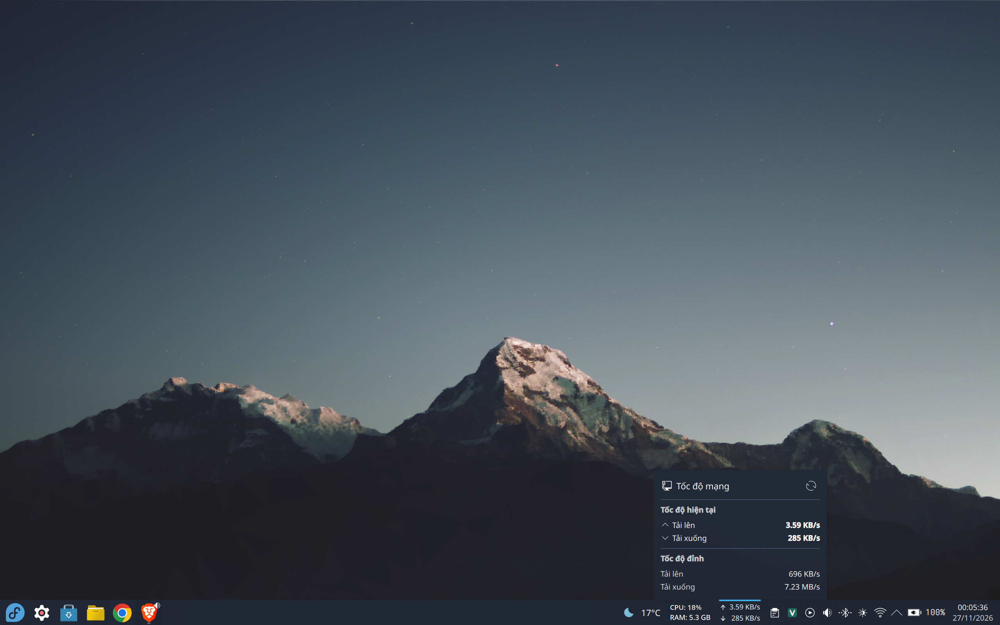
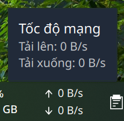
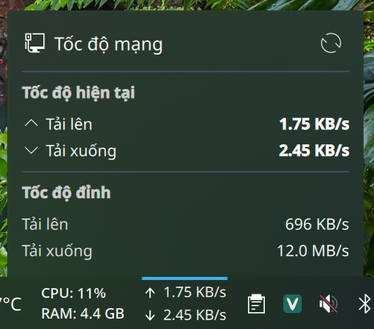

# Modern Network Speed (KDE Plasma 6 Widget)

[English](README_en.md) | **Tiếng Việt**

Widget hiển thị tốc độ mạng hiện đại hỗ trợ bố cục **2 dòng** (mặc định) hoặc **1 dòng** cho KDE Plasma 6 (sử dụng cảm biến native `org.kde.ksysguard.sensors`, không cần cài thêm phần mềm phụ trợ).

## Ảnh chụp màn hình / Screenshots



| Di chuột / Hover | Chi tiết / Popup |
| :---: | :---: |
|  |  |

## Tính năng chính / Features

- **Hiển thị 2 dòng / 1 dòng gọn gàng (Two-Line / One-Line Monitor):**
  - Mặc định hiển thị **2 dòng trên dưới** (trên: biểu tượng tải lên `go-up` + tốc độ upload; dưới: biểu tượng tải xuống `go-down` + tốc độ download), hỗ trợ chuyển sang kiểu **1 dòng ngang** trong phần cài đặt.
  - Tương thích thanh Panel (ngang & dọc) và Desktop, kèm popup xem tốc độ hiện tại, tốc độ đỉnh (Peak) và nút đặt lại khi nhấp vào.
- **Tùy chỉnh giao diện từng dòng độc lập (Independent Line Styling):**
  - Kiểu chữ (Font family) và cỡ chữ (`6–72 pt`) riêng cho dòng Upload và Download.
  - Định dạng In đậm / In nghiêng và chọn màu sắc tùy ý (hoặc dùng màu chủ đề hệ thống).
  - Tùy chọn kiểu hiển thị (**2 dòng** hoặc **1 dòng**) và khoảng cách (`0–20 px`) kèm khung xem trước trực tiếp (Live Preview).
- **Tùy chỉnh đơn vị & tần suất cập nhật (Configurable Units & Polling):**
  - Đơn vị tốc độ: Hệ thập phân (`B/s`, `KB/s`, `MB/s`...), Hệ nhị phân (`B/s`, `KiB/s`, `MiB/s`...) hoặc Bit (`b/s`, `Kb/s`, `Mb/s`...).
  - Chu kỳ làm mới linh hoạt từ `500 ms` đến `10000 ms`.
- **Song ngữ Anh / Việt (English & Vietnamese):**
  - Mặc định tự động nhận diện ngôn ngữ hệ điều hành, tự động fallback sang tiếng Anh nếu hệ điều hành dùng ngôn ngữ khác.
  - Có thể chọn thủ công Tiếng Việt hoặc English trong phần cài đặt.
- **Cảm biến native Plasma 6 (Native Sensors):**
  - Sử dụng `org.kde.ksysguard.sensors` (`network/all/upload`, `network/all/download`) từ `ksystemstats` + `libksysguard`, tích hợp sẵn trên mọi bản cài KDE Plasma 6 tiêu chuẩn.

## Cài đặt / Cập nhật / Gỡ bỏ

```bash
# Cài đặt lần đầu
./install.sh

# Cập nhật sau khi chỉnh sửa source (thêm --restart để tự khởi động lại plasmashell và áp dụng ngay)
./update.sh
./update.sh --restart

# Gỡ bỏ hoàn toàn (thêm --restart để reload plasmashell ngay)
./uninstall.sh
./uninstall.sh --restart
```

Hoặc dùng trực tiếp `kpackagetool6`:

```bash
kpackagetool6 --type Plasma/Applet --install .
kpackagetool6 --type Plasma/Applet --upgrade .
kpackagetool6 --type Plasma/Applet --remove com.modern.networkspeed
```

## Ghi công & Giấy phép / Credits & Licenses

- **System Sensors:** [KDE KSysGuard / KSystemStats](https://kde.org/plasma-desktop/) (`org.kde.ksysguard.sensors`) — tích hợp sẵn trong KDE Plasma 6.
- **Widget License:** Copyright (C) 2026 [duynguyenvp](https://github.com/duynguyenvp) — [GNU General Public License v3.0 or later (GPL-3.0-or-later)](LICENSE).
- **Repository:** [github.com/duynguyenvp/kde-modern-network-speed](https://github.com/duynguyenvp/kde-modern-network-speed)
