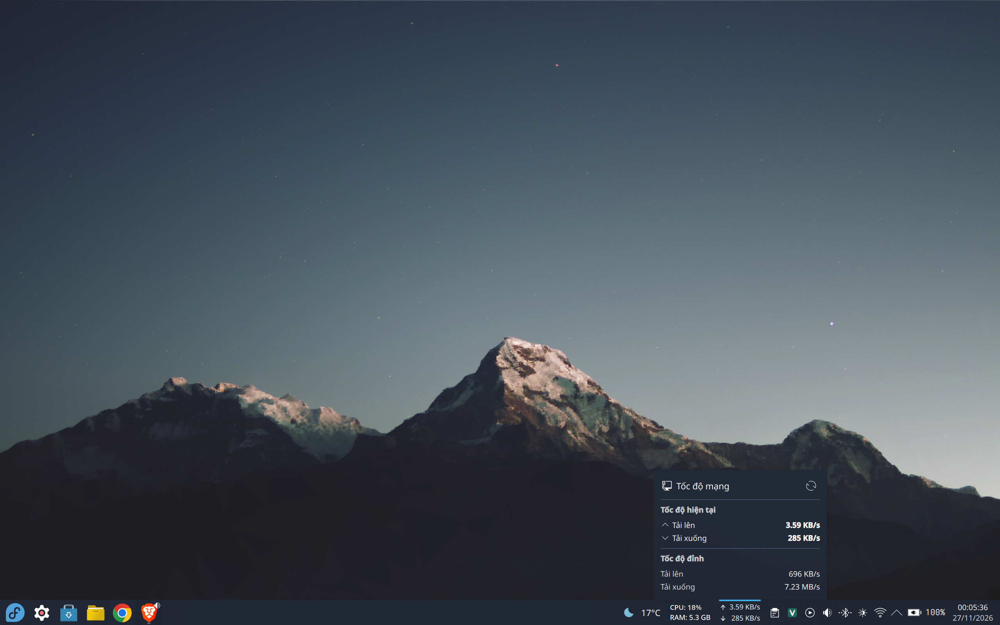
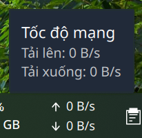
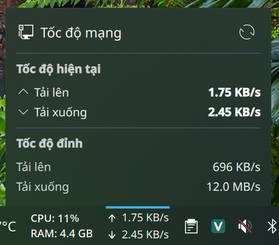

# Modern Network Speed (KDE Plasma 6 Widget)

**English** | [Tiếng Việt](README.md)

A modern **2-line** (default) or **1-line** network speed monitor widget for KDE Plasma 6 powered by native `org.kde.ksysguard.sensors` (no external tools or dependencies required).

## Screenshots



| Hover | Popup |
| :---: | :---: |
|  |  |

## Features

- **Two-Line / One-Line Monitor:**
  - Defaults to a **2-line (stacked)** layout (top: upload icon `go-up` + upload speed; bottom: download icon `go-down` + download speed), with an option to switch to a **1-line (inline)** layout on horizontal panels.
  - Compatible with horizontal & vertical Panels as well as the Desktop, with a click popup showing current speeds, peak speeds, and a reset button.
- **Independent Line Styling:**
  - Separate font family and font size (`6–72 pt`) for Upload and Download lines.
  - Independent Bold / Italic toggles and custom colors (or automatic system theme color).
  - Switchable **2-line / 1-line** layout and adjustable spacing (`0–20 px`) with a Live Preview in settings.
- **Configurable Units & Polling:**
  - Speed units: Decimal (`B/s`, `KB/s`, `MB/s`...), Binary (`B/s`, `KiB/s`, `MiB/s`...), or Bits (`b/s`, `Kb/s`, `Mb/s`...).
  - Flexible refresh interval from `500 ms` to `10000 ms`.
- **Bilingual (English & Vietnamese):**
  - Automatically detects the OS language by default and falls back to English for other languages.
  - Manually switchable between English and Vietnamese in the widget settings.
- **Native Plasma 6 Sensors:**
  - Uses `org.kde.ksysguard.sensors` (`network/all/upload`, `network/all/download`) from `ksystemstats` + `libksysguard`, included out of the box in standard KDE Plasma 6 installations.

## Installation / Update / Uninstall

```bash
# First-time installation
./install.sh

# Update after modifying source (add --restart to reload plasmashell immediately)
./update.sh
./update.sh --restart

# Completely remove the widget (add --restart to reload plasmashell immediately)
./uninstall.sh
./uninstall.sh --restart

# Build a .plasmoid package
./build.sh
```

Or use `kpackagetool6` directly:

```bash
kpackagetool6 --type Plasma/Applet --install .
kpackagetool6 --type Plasma/Applet --upgrade .
kpackagetool6 --type Plasma/Applet --remove com.modern.networkspeed
```

## Credits & Licenses

- **System Sensors:** [KDE KSysGuard / KSystemStats](https://kde.org/plasma-desktop/) (`org.kde.ksysguard.sensors`) — built into KDE Plasma 6.
- **Widget License:** Copyright (C) 2026 [duynguyenvp](https://github.com/duynguyenvp) — [GNU General Public License v3.0 or later (GPL-3.0-or-later)](LICENSE).
- **Repository:** [github.com/duynguyenvp/kde-modern-network-speed](https://github.com/duynguyenvp/kde-modern-network-speed)
